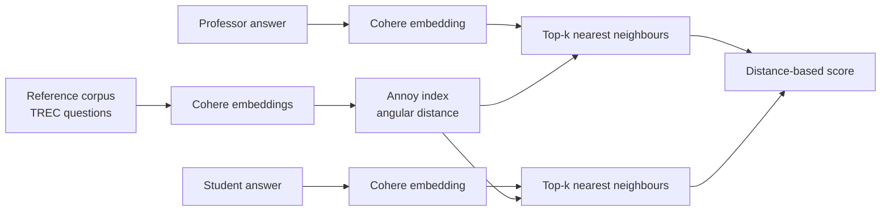

# Smart Grader

**Prototype of an NLP-based answer grader (Jan 2023, BTech project).**
Smart Grader compares a student's free-text answer with the professor's model answer using semantic embeddings, and returns a score — an early experiment in using sentence embeddings instead of keyword matching for automated grading.

`Python` · `Streamlit` · `Cohere Embed` · `Annoy (approximate nearest neighbours)` · `Hugging Face Datasets` · `pandas`

<!-- DEMO: add a screenshot or the demo video link here, e.g. [▶ Demo video](https://youtu.be/...) -->

## How it works



1. **Semantic index.** Questions from the TREC dataset are embedded with Cohere's embedding model and stored in an Annoy approximate-nearest-neighbour index (angular distance, 10 trees).
2. **Answer embedding.** The professor's answer and the student's answer are each embedded and matched to their nearest neighbours in the index.
3. **Scoring.** The two answers' neighbour distances are compared, and the difference is mapped to a score with a log-scaled function: answers that land in the same semantic region score higher.
4. **UI.** A Streamlit front end shows both answers side by side, their nearest neighbours, and the final score.

## Running it

```bash
pip install -r requirements.txt
export COHERE_API_KEY=your_key_here   # Windows PowerShell: $env:COHERE_API_KEY="your_key_here"
streamlit run app.py
```

## Limitations and what I'd do differently today

This was an early prototype, and its scoring is indirect: it compares each answer's distance to an unrelated reference corpus rather than comparing the two answers directly. Rebuilding it now, I would:

- score with **direct cosine similarity** between the professor and student answer embeddings, plus rubric-point coverage;
- use an **LLM-as-judge with a structured rubric** (schema-constrained output) and calibrate it against human-graded answers;
- evaluate agreement with human graders (e.g. Pearson correlation / QWK) on a public short-answer grading dataset.

## License

Apache 2.0 — see [LICENSE](LICENSE).
